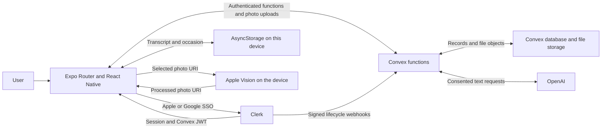

# Architecture

Zwag has four runtime boundaries. The app handles interaction and image preprocessing. Convex owns application data and verifies access. Clerk manages identities and sessions. OpenAI receives consented text requests from Convex.

## Boundaries

| Boundary | Responsibility | Entry point |
| --- | --- | --- |
| Mobile app | Routing, chat transcript, permissions, outfit rendering | [Root layout](../app/_layout.tsx) |
| Authentication | OAuth, active session, signed identity | [Clerk and Convex provider](../providers/ClerkandConvexProvider.tsx), [Convex auth config](../convex/auth.config.ts) |
| Convex queries and mutations | Resolve the caller, enforce ownership, read or write records | [User access checks](../convex/users.ts), [Schema](../convex/schema.ts) |
| Convex actions | Call external APIs, plan chat turns, generate outfits, run deletion jobs | [Chat](../convex/stylistChat.ts), [Outfit generation](../convex/generateOutfits.ts), [Deletion](../convex/accountDeletion.ts) |
| Convex HTTP | Receive signed Clerk events and authenticated photo uploads | [HTTP routes](../convex/http.ts) |
| Native image processing | Generate an optional foreground mask on iOS | [Vision Expo module](../modules/vision-bg-remover/ios/VisionBgRemoverView.swift) |
| Local persistence | Store chat messages and occasion for the device and Clerk account | [Local chat storage](../lib/localChatStorage.ts) |

The app holds public connection settings. Convex holds service credentials. The phone requests an outfit, and the backend uses its own closet records and deterministic rules to decide which item IDs are valid.

## Route map

| Route or group | Purpose | Implementation |
| --- | --- | --- |
| `/` | Resolve account state and choose an entry route | [app/index.tsx](../app/index.tsx) |
| `/onBordingScreens/welcome` and `/(auth)/sign-up` | Welcome and Apple or Google sign-in | [Welcome](../app/onBordingScreens/welcome.tsx), [Sign-up](../app/%28auth%29/sign-up.tsx) |
| `/account-status` | Provision a missing profile and show deletion state | [Account status](../app/account-status.tsx) |
| `/(tabs)` | Closet home and category previews | [Closet](../app/%28tabs%29/index.tsx) |
| `/(tabs)/recents` | Fits, the saved outfits view | [Fits](../app/%28tabs%29/recents.tsx) |
| `/(tabs)/chat` | Consent gate, transcript, and outfit cards | [Chat screen](../app/%28tabs%29/chat.tsx) |
| `/screens/closet/*` | Photo capture, removal, editing, and browsing | [Closet screens](../app/screens/closet) |
| `/screens/menu` | Preferences, privacy settings, sign-out, and deletion | [Menu](../app/screens/menu.tsx) |

Parentheses mark Expo Router route groups. The [tab layout](../app/%28tabs%29/_layout.tsx) and [screens layout](../app/screens/_layout.tsx) redirect accounts that cannot use the app. Convex independently authorizes each protected operation.

## Repository map

| Location | Look here for |
| --- | --- |
| [app/](../app) | Routes and screen-level state |
| [components/](../components), [modals/](../modals) | Reusable UI and dialogs |
| [constants/](../constants), [config/](../config) | Theme, clothing taxonomy, consent disclosure, model prompt |
| [providers/](../providers), [hooks/](../hooks) | App-wide services and shared React logic |
| [convex/](../convex) | API handlers, records, scheduled work, and generated types |
| [lib/](../lib) | Outfit rules and on-device chat persistence |
| [modules/vision-bg-remover/](../modules/vision-bg-remover) | Linked custom Expo module for photo background removal |
| [ios/](../ios), [android/](../android) | Checked-in native build projects |
| [scripts/](../scripts) | Synthetic regression tests |

## State ownership

| State | Authoritative location |
| --- | --- |
| Current login session | Clerk |
| Account status, closet, files, saved outfits, and outfit activity | Convex |
| Current input, busy state, and failed turn awaiting Retry | React state and refs |
| Restored chat, outfit card references, and selected occasion | Per-account AsyncStorage on this installation |
| Recently loaded Fits list | In-memory cache in [useCachedOutfits](../hooks/useCachedOutfits.ts) backed by a live Convex query |

A saved outfit stores references to garment records. Edits or deletions can change what an old outfit card renders. The transcript can be restored locally, while suggestions, file upload, and cloud queries need connectivity.
