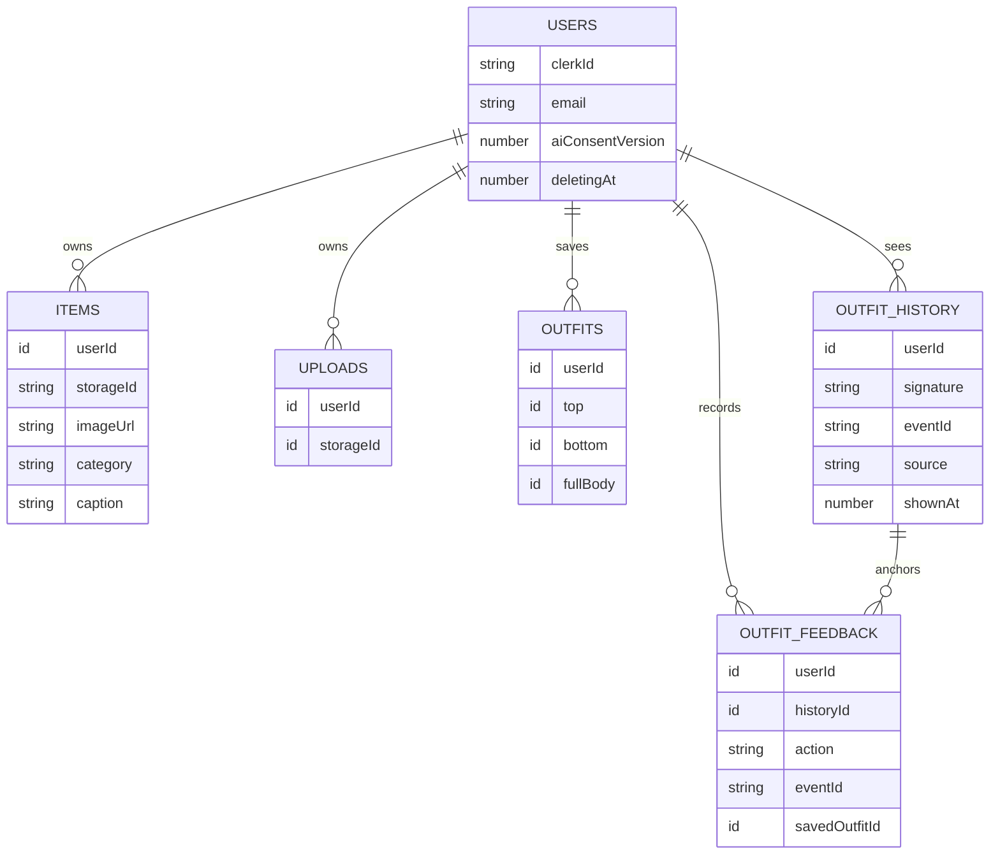

# Data model and API reference

[convex/schema.ts](../convex/schema.ts) defines persistent records and indexes. A typed Convex document ID indicates a table. Authorization still checks that the row belongs to the caller.

The diagram highlights ownership and representative fields. Outfit slots refer to `items._id`. Both `outfitHistory.itemIds` and `outfitFeedback.itemIds` store the selections by ID. `outfitFeedback.savedOutfitId` is populated for save events. An item may later be deleted while a historical reference remains.

| Table | Responsibility | Useful indexes |
| --- | --- | --- |
| `users` | Clerk mapping, preferences, consent and quota, deletion state | `byClerkId` |
| `items` | Owned garment metadata and file reference | `by_userId`, `byStorageId`, and owner-plus-attribute indexes |
| `uploads` | Pending file ownership before item creation | `byUser`, `byStorage` |
| `outfits` | Saved outfit slots | `byUser` |
| `outfitHistory` | Shown outfits, signatures, source, occasion, and event IDs | `by_user`, `by_user_signature`, `by_user_event` |
| `outfitFeedback` | Save, dislike, and try-another events | `by_user`, `by_user_event` |
| `deletedAccounts` | Clerk ID marker that guards against delayed profile recreation | `byClerkId` |
| `inviteCodes` | Old invite rows retained for deletion cleanup | `byCode` |

The [outfit validators](../convex/outfitDataValidators.ts) define optional slot shape and the source enum. The semantic rules live in [lib/outfitRules.ts](../lib/outfitRules.ts). Optional legacy fields in the schema let existing records survive changes to the app flow.

## App-facing functions

Arguments below show the most useful fields for tracing calls. Use the linked handler’s validators for the full contract. Except for status before sign-in, the documented reads and writes require an authenticated caller. Closet and outfit operations require an active profile.

| Operation | Kind | Input and result |
| --- | --- | --- |
| [`users:getAccountStatus`](../convex/users.ts) | Query | No arguments. Returns account readiness, access, consent, and deletion flags, or `null` without identity. |
| [`users:prepareMyProfile`](../convex/users.ts) | Mutation | No arguments. Provisions the caller if needed and checks the deletion marker. |
| [`users:getCurrentUser`](../convex/users.ts) | Query | Reads the caller’s active profile. |
| [`users:updateStylePreferences`](../convex/users.ts) | Mutation | Patches supplied preference fields. The current settings screen exposes occasions and clothes to avoid. |
| [`users:setAiConsent`](../convex/users.ts) | Mutation | `{ allowed, version }`. Grants current-version consent or clears consent. |
| [`items:uploadItem`](../convex/items.ts) | Mutation | Owned `storageId` plus item metadata. Creates an item and returns its ID. |
| [`items:getItem` and `items:getOneItemById`](../convex/items.ts) | Queries | List filtered owned items or get a specific item by ID. |
| [`items:getPreviewImageByCategory` and `items:countItemsByCategory`](../convex/items.ts) | Queries | Build the Closet category previews and counts. |
| [`items:getOutfitItemsFromAi`](../convex/items.ts) | Query | Resolve slot IDs to owned, current item data for rendering. |
| [`items:updateItem` and `items:deleteItem`](../convex/items.ts) | Mutations | Edit or delete an owned garment. |
| [`stylistChat:sendMessage`](../convex/stylistChat.ts) | Action | `{ messages, context: { occasion } }`. Returns `{ reply, context, suggestion? }`. |
| [`generateOutfits:analyzeOutfit`](../convex/generateOutfits.ts) | Action | `{ preferredItemsId, occasion?, instructions? }`. Returns `{ outfit, source, occasion }` or a user-facing error. |
| [`outfitHistory:recordShown`](../convex/outfitHistory.ts) | Mutation | Suggestion and `eventId`. Validates and returns an `outfitHistory` ID. |
| [`outfitHistory:logFeedback`](../convex/outfitHistory.ts) | Mutation | `{ historyId, action, eventId }` for dislike or try-another. |
| [`outfits:saveOutfit`](../convex/outfits.ts) | Mutation | `{ historyId, eventId }`. Saves an owned, currently valid shown outfit and records feedback together. |
| [`outfits:getOutfits`, `outfits:getOutfitByOutfitId`, `outfits:deleteOutfit`](../convex/outfits.ts) | Queries, mutation | List, read, or delete owned saved outfits. |
| [`accountDeletion:deleteAccount`](../convex/accountDeletion.ts) | Mutation | No arguments. Queues cleanup for the caller. |

A history ID identifies a shown suggestion. A saved-outfit ID identifies a row in Fits. An event ID identifies a client event within the relevant account and history or feedback table. The mutations reject conflicting event reuse and can return a previous result when an event is replayed.

## HTTP and internal operations

| Interface | Caller and responsibility |
| --- | --- |
| [`POST /clerk-webhook`](../convex/http.ts) | Clerk sends Svix-signed events to the Convex site URL. Valid events dispatch to internal account handlers. |
| [`POST /closet-upload`](../convex/http.ts) | The authenticated app sends raw PNG or JPEG bytes with a Convex JWT. Success returns `{ storageId }`. Identity, type, size, or registration failures return an HTTP error. |
| [`outfitHistory:generationContext`](../convex/outfitHistory.ts) | Supplies the outfit action with the current owner’s closet and shown selections. |
| [`users:authorizeAiRequest`](../convex/users.ts) | Checks access and current consent, then atomically consumes request quota. |
| [`items:registerUpload`](../convex/items.ts) | Attaches pending file ownership to the verified caller. |
| [Deletion workers](../convex/accountDeletion.ts) | Batch cleanup, schedule follow-up or retries, delete Clerk identity when needed, and finish the account deletion. |

The SDK’s generated `api` and `internal` namespaces make the visibility distinction explicit. [Convex function visibility](https://docs.convex.dev/functions/internal-functions)
