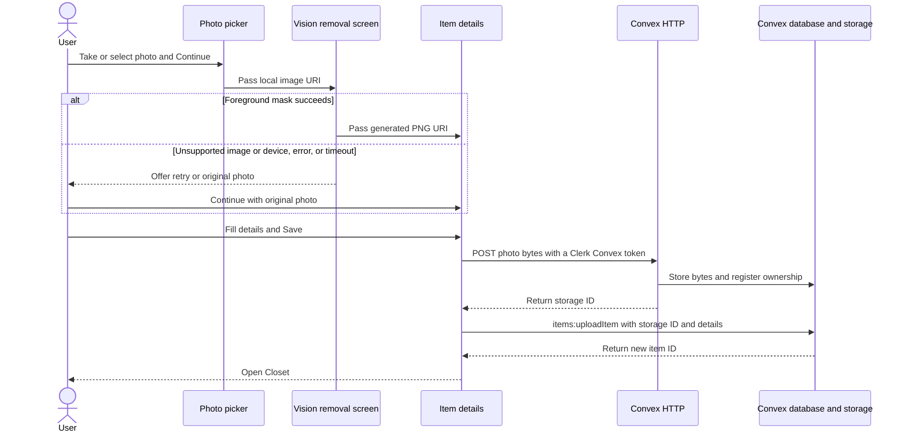

# Closet and image uploads

One clothing item consists of a Convex record and an image in Convex file storage. The user supplies the item’s category, subcategory, caption, style, color, and brand from the app. Background removal processes the image on the phone.

## Photo pipeline

| Step | Implementation | Result |
| --- | --- | --- |
| Choose an image | [addItem.tsx](../app/screens/closet/addItem.tsx) | Camera permission is requested when the user chooses the camera. The library option opens the OS picker. |
| Remove the background | [visionKitRemoval.tsx](../app/screens/closet/visionKitRemoval.tsx) and [VisionBgRemoverView.swift](../modules/vision-bg-remover/ios/VisionBgRemoverView.swift) | iOS Vision uses `VNGenerateForegroundInstanceMaskRequest` and writes a PNG. The screen enforces a 30-second timeout. |
| Prepare upload | `saveToWardrobe` in [addedItem.tsx](../app/screens/closet/addedItem.tsx) | Re-encodes the photo as PNG or JPEG, obtains a Clerk token for the `convex` template, and sends binary bytes via the legacy Expo FileSystem API. |
| Store and register the file | [HTTP router](../convex/http.ts) and the internal `items:registerUpload` mutation in [items.ts](../convex/items.ts) | Requires an active account, allows PNG and JPEG with matching file signatures, caps the request at 10 MiB, and returns a storage ID. |
| Create the item | Public `items:uploadItem` in [items.ts](../convex/items.ts) | Confirms ownership of the upload, resolves the image URL, inserts the item, and removes the pending-upload row in the same mutation. |

The active package is [`vision-bg-remover`](../modules/vision-bg-remover/package.json), linked in [package.json](../package.json). `visionKitRemoval.tsx` is the route name. The native implementation uses Apple Vision, and Android and web have no equivalent foreground extraction in the linked module.

## If a save is interrupted

An uploaded file can exist before its item record. The `uploads` table tracks the owner during that interval. The upload registration mutation reclaims the oldest pending file when adding one would exceed ten pending uploads for the account. Account deletion also removes pending uploads. Cleanup of unowned files from older clients requires a separate audit.

If ownership registration fails, the HTTP handler checks for an existing registration before attempting to remove the stored file. The UI removes its re-encoded temporary upload file on a best-effort basis after a save attempt.

## Read, edit, and delete

| UI | Convex calls |
| --- | --- |
| [Closet home](../app/%28tabs%29/index.tsx) | `items:getPreviewImageByCategory`, `items:countItemsByCategory` |
| [Browse by category](../app/screens/closet/browseItems.tsx) | `items:getItem` with query filters |
| [Item details](../app/screens/closet/itemViewDetail.tsx) | `items:getOneItemById`, `items:updateItem`, `items:deleteItem` |
| [Outfit card](../components/StylistOutfitCard.tsx) | `items:getOutfitItemsFromAi` with slot IDs |

When deleting an item, the backend checks for other legacy item references before removing the stored file. Saved outfits and history retain their IDs, so a previously shown garment can become unavailable. [Data model and API reference](backend-reference.md)
