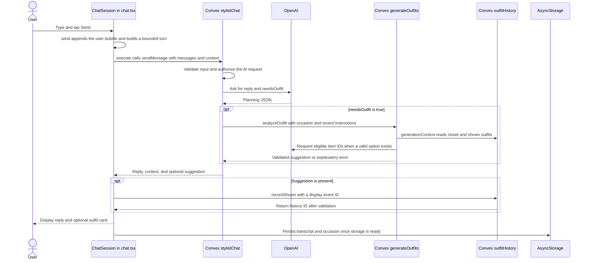

# Code walkthrough

To trace a feature, start with the button handler in `app/`, follow the `api.module.function` reference, and open the corresponding export in `convex/module.ts`. For example, `useAction(api.stylistChat.sendMessage)` calls the exported `sendMessage` action in [convex/stylistChat.ts](../convex/stylistChat.ts).

## Which React and Convex functions do what

| Function or pattern | Role in Zwag |
| --- | --- |
| `useState` | Holds values the screen renders, such as input text, messages, and loading state. |
| `useEffect` | Synchronizes side effects such as restoring or saving local chat. |
| `useRef` | Holds values without triggering renders, such as a busy guard, a list handle, or the last failed turn. |
| `useQuery` | Subscribes to a reactive Convex read. The first result may be `undefined` while loading. |
| `useMutation` | Returns a callable function that changes Convex records. |
| `useAction` | Returns a callable function that can perform network operations, including OpenAI calls. |
| `api.*` and `internal.*` | Generated references for public and internal functions. The implementations remain in the domain files. |

## One chat turn



| Call | What to look for |
| --- | --- |
| `ChatScreen` in [chat.tsx](../app/%28tabs%29/chat.tsx) | Reads account status. Mounts `ChatSession` after consent. |
| `ChatSession.send` | Trims input, adds the user bubble immediately, and strips local message fields from the outgoing history. |
| `ChatSession.execute` | Logs feedback when supplied, calls chat, awaits `recordShown` if needed, and then appends the assistant bubble. |
| `stylistChat:sendMessage` in [stylistChat.ts](../convex/stylistChat.ts) | Reads `response.choices[0]`, verifies a completed response, parses the JSON, and checks `plan.needsOutfit`. A false value returns text early. |
| `generateOutfits:analyzeOutfit` in [generateOutfits.ts](../convex/generateOutfits.ts) | Loads canonical closet records, selects valid garments, and returns an outfit or throws a deliberate error. |
| `outfitHistory:recordShown` in [outfitHistory.ts](../convex/outfitHistory.ts) | Rechecks ownership and eligibility before creating the shown record. |
| [StylistOutfitCard](../components/StylistOutfitCard.tsx) | Resolves garment IDs into current closet photos and labels. It passes button clicks back to `ChatSession`. |

## Example turn

The user types “Something casual for dinner.” `send` sends a list like the following, along with `context`. The text here uses a synthetic conversation.

```json
{
  "messages": [
    { "role": "user", "content": "Something casual for dinner." }
  ],
  "context": { "occasion": "Casual" }
}
```

The planner may set `needsOutfit` to `true` and update `occasion` to `Casual dinner`. Zwag gives the selector the actual eligible closet items, then attaches a history ID after recording the result. The card can now resolve details for the specific garments and offer Save, Not my style, and Try another.

## How Save and reactions work

| User action | Sequence |
| --- | --- |
| **Save outfit** | `save` → `outfits:saveOutfit` with `historyId` and `eventId` → the server verifies the current closet and atomically writes the saved outfit plus save feedback. |
| **Not my style** | `another` → `send` → `execute` → `outfitHistory:logFeedback` with `dislike` → a new chat request using the clicked outfit’s occasion. |
| **Try another** | Same reaction path with `try_another`. The shown-history query helps exclude the earlier outfit. |
| **Retry** | Replays the last failed turn retained in a ref. Its feedback event ID stays stable so the server can de-duplicate that feedback. The model call can run again. |

## What survives an app restart

[localChatStorage.ts](../lib/localChatStorage.ts) stores `{ messages, context }` under `zwag:chat:v1:<Clerk user ID>`. `messages` contains the visible transcript and any outfit-card references. `context` carries the current occasion or vibe. The screen restores both before enabling persistence. The input box and in-flight request state are session state. The transcript lives on this installation, while saved outfits and shown history live in Convex.

## Other useful entry points

- For sign-in and routing, start with [app/index.tsx](../app/index.tsx) and [onboarding](onboarding-flow.md).
- For clothing upload, start with [addItem.tsx](../app/screens/closet/addItem.tsx) and follow the [photo sequence](closet.md).
- For settings and account deletion, start with the [menu](../app/screens/menu.tsx) and follow the [deletion sequence](privacy.md#account-deletion).
