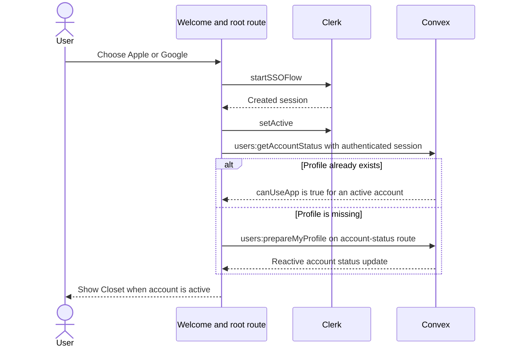

# Onboarding and authentication

Welcome offers Apple and Google sign-in through Clerk. A signed-in user can open the Closet as soon as their Convex profile exists and is active.

## Which file does what

| File | Responsibility |
| --- | --- |
| [Welcome](../app/onBordingScreens/welcome.tsx) and [sign-up](../app/%28auth%29/sign-up.tsx) | Run the selected OAuth flow and activate the returned session. |
| [Provider](../providers/ClerkandConvexProvider.tsx) | Uses Clerk’s token cache and connects Convex requests to Clerk. |
| [Account status hook](../hooks/useAccountStatus.ts) | Waits for auth and subscribes to `users:getAccountStatus` when authenticated. |
| [Root route](../app/index.tsx) | Routes signed-out users to Welcome, active users to Closet, and other signed-in users to account status. |
| [Account-status route](../app/account-status.tsx) | Calls `prepareMyProfile` if provisioning is pending and displays deletion, retry, and sign-out states. |
| [User backend](../convex/users.ts) | Maps Clerk identity to an owned Convex profile, derives access status, and maintains preferences and consent. |
| [Webhook router](../convex/http.ts) | Verifies signed Clerk events before invoking internal provisioning or deletion functions. |

The signed `user.created` webhook can create the profile before the app opens it. If the app arrives first, `prepareMyProfile` creates the row for the verified caller, initially with an empty email. A later verified create event can fill the email. Both paths check for an existing row and a deletion marker.

## Identity and authorization

- **Clerk user ID** is the stable identity subject. Convex stores it as `users.clerkId`.
- **Convex user ID** is the `users._id` document ID. Closet records, outfits, history, and feedback use it as their owner.
- **`requireActiveUser(ctx)`** resolves the caller and rejects accounts undergoing deletion. Individual operations also verify ownership of the requested record.

Style preferences can be edited from the [menu’s preferences screen](../app/screens/menuScreens/stylePreferences.tsx). The [old questionnaire route](../app/onBordingScreens/styleQuestionnaire.tsx) redirects to the root route. Active onboarding uses neither measurements nor invite codes. The [privacy guide](privacy.md) explains the remaining legacy fields and account deletion.
