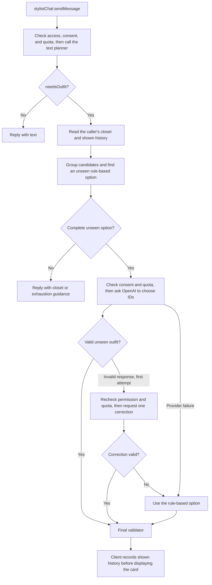

# Outfit generation

The chat planner decides whether the user wants fashion advice or an outfit. For an outfit, a second stage chooses from the signed-in user’s eligible closet items. Zwag validates every outfit before it reaches the transcript.

## What each model stage receives

| Stage | Sent to OpenAI | Output contract |
| --- | --- | --- |
| Plan the turn | System instructions, the current occasion or vibe, and up to 20 recent messages of up to 2,000 characters each and 16,000 characters total. | JSON with `reply`, `needsOutfit`, and an optional updated `occasion`. The last user message must be non-empty. |
| Choose the outfit | Eligible candidates with IDs, categories, subcategories, captions, colors, and style tags. Includes occasion, eligible preferred IDs if supplied, previous outfit selections by ID, and conversation instructions derived from the last eight messages and capped at 6,000 characters. | A JSON object of outfit slots containing item IDs from the corresponding candidate groups. |

The planner has no closet context unless a user describes their clothes in chat. The selection prompt excludes file URLs, image bytes, brands, and embeddings as structured fields. User-entered free text can contain additional information. The current chat path sends an empty `preferredItemsId` list. Style preferences stored from the menu are separate from the conversational context. Weather is a legacy history field and is outside the active generation flow.

Read [stylistChat.ts](../convex/stylistChat.ts), [generateOutfits.ts](../convex/generateOutfits.ts), and [gptPrompt.ts](../config/gptPrompt.ts).

## Validation rules

| Rule | Failure caught |
| --- | --- |
| Use a top and a bottom, or exactly one full-body garment as the base | Incomplete or mixed bases |
| Each ID must exist in the candidates for its slot | Invented IDs, unavailable garments, and wrong categories |
| Each item ID can appear only once | The same garment in multiple slots |
| Shoes and outerwear are optional single items. Accessories are optional with one to five IDs. | Unsupported structures and oversized accessory lists |
| An outfit’s sorted item IDs make its signature | Exact repeats even when slot output or accessory order changes |

`buildCandidates` normalizes categories, de-duplicates IDs, and moves preferred items ahead of other candidates. `validateOutfit` enforces the rules above. `ruleBasedOutfit` lazily enumerates combinations and returns the first valid unseen option. The deterministic fallback uses slot eligibility and history as its criteria. [Outfit rules source](../lib/outfitRules.ts)

## Failure and retry behavior

- The outfit action first needs a valid unseen fallback. If the closet has no complete new combination, chat can return an explanation without requesting model-based selection.
- A malformed or invalid selection gets one model repair attempt. If repair fails validation or the provider returns an error during selection, the rule-based option can still be returned.
- The source field is `ai` when the model’s selection passed and `rules` when deterministic selection supplied the result.
- The server checks consent and the request limit before each OpenAI call. A rejected consent or quota check exits the outfit action with a user-facing error.
- A provider failure in the initial planning call shows an error and **Retry**. The outfit fallback belongs to the selection stage.

An advice turn normally uses one OpenAI request. An outfit turn normally uses two and can use a third for repair. The 30-request per-account allowance resets by UTC day. See [privacy](privacy.md#consent-and-request-limits) and [testing](testing.md#automated-checks).

## When an outfit becomes history

Generating an outfit returns a suggestion. The client then calls `outfitHistory:recordShown`, which validates the current closet again and writes a shown-history row. The row’s ID anchors save and feedback operations. Exact repeats are checked both during generation and when recording a result, so a concurrent generation cannot silently display the same combination twice.

For the exact phone-to-backend call chain, see the [code walkthrough](code-walkthrough.md#one-chat-turn).
