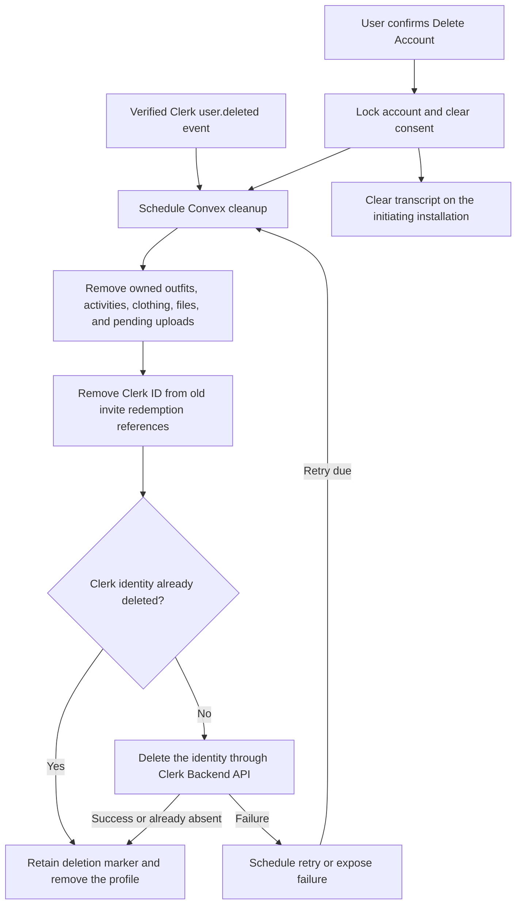

# Privacy and account deletion

This is the engineering data-flow guide. The in-app disclosure and privacy controls live in [PrivacyModal.tsx](../modals/PrivacyModal.tsx) and [aiConsent.ts](../constants/aiConsent.ts).

## Where data lives

| Data | Location and use |
| --- | --- |
| Social login and session | Clerk manages the account and session. Convex verifies the Clerk token and stores the corresponding Clerk ID and the primary email when available. |
| Garment photos | Processed on the device and stored in Convex when the user saves a garment. Photos and image URLs are outside the structured OpenAI request. |
| Clothing descriptions, labels, and style preferences | Convex stores closet metadata and profile preferences. The outfit selection prompt projects a subset of garment attributes. |
| Chat messages and occasion | A device-local AsyncStorage transcript. The app sends a bounded portion to the Convex chat action for a turn. Consented OpenAI requests process that text. |
| Outfit history, saved outfits, and feedback | Convex stores garment references and event metadata per account. The selection prompt includes earlier outfit selections by ID. |
| Consent and request usage | Convex stores the disclosure version and acceptance time, plus the UTC day and count for model requests. |

See [outfit generation](outfit-generation.md#what-each-model-stage-receives) for the exact request fields. Provider retention and backup behavior depend on the deployed account settings. Review them before publishing a public privacy policy.

## Consent and request limits

1. [ChatScreen](../app/%28tabs%29/chat.tsx) reads `getAccountStatus`. A user without current consent sees the disclosure and can allow sharing or return to Closet.
2. `users:setAiConsent` persists the version and time on acceptance. **Privacy & Security** can clear both values.
3. Before each model request, `users:authorizeAiRequest` checks the verified active user and consent version, then increments that account’s daily count. Planning, selection, and repair each use one of the 30 requests per UTC day.
4. Revocation applies to future authorization checks. A request already sent to OpenAI can continue.

If the disclosure changes materially, update the text and bump `AI_CONSENT_VERSION` together. Check both the app’s gating behavior and the backend’s rejection of stale consent.

## Account deletion

[useDeleteAccount.ts](../hooks/useDeleteAccount.ts) starts deletion for the authenticated caller and attempts local cleanup. [accountDeletion.ts](../convex/accountDeletion.ts) records progress and runs scheduled batches. `requireActiveUser` blocks protected access while cleanup is in progress. The scheduler retries failed cleanup with backoff, then exposes a retry state after the limit.

A signed Clerk deletion event uses the same worker and can skip the Clerk API removal step. `deletedAccounts` retains the Clerk identifier to prevent a delayed webhook or still-valid token from recreating the profile. The app also clears the local transcript when it observes deletion for the current account. Devices that never observe the state can retain local cached data.

Clerk account deletion and Apple OAuth token revocation are separate. The app gives manual Apple revocation instructions for an Apple-linked account. Verify revocation behavior for the production integration. [Apple’s account deletion guidance](https://developer.apple.com/documentation/technotes/tn3194-handling-account-deletions-and-revoking-tokens-for-sign-in-with-apple)

## Legacy data

Height, weight, body type, and birth year remain as optional fields for existing records. `users:clearLegacyMeasurements` offers a cursor-based migration with a dry-run flag. The [release runbook](release-readiness.md#data-migrations) includes the review procedure. The optional garment `embedding` field is reserved. The current outfit engine uses categorical rules and an OpenAI prompt.
